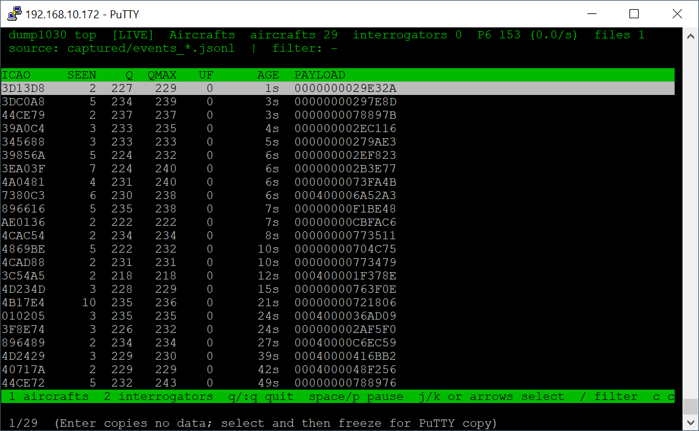

# dump1030

`dump1030` is a C++17 receiver for detecting 1030-MHz Secondary Surveillance
Radar (SSR) interrogations and decoding Mode S P6 uplinks. It supports runtime
sample rates from 2.0 to 30 MS/s and can read from:

- RTL-SDR as unsigned 8-bit I/Q (`cu8`)
- PlutoSDR/AD9361 through optional libiio support as signed 16-bit I/Q (`sc16`)
- Offline files or `stdin` in `cu8` or `sc16` format

The detector covers Mode A, Mode C, A/C All-Call, A/C/S All-Call, and Mode S.
The experimental P6 decoder uses a 64-state Viterbi equalizer, learns its
receiver channel with `p6sim.py`, recovers protocol fields and target ICAO
addresses, and applies quality gates before JSONL output.

This project is a fork of
[Fuziih's dump1030](https://github.com/Fuziih/dump1030), which builds on
[antirez's dump1090](https://github.com/antirez/dump1090).

## Requirements and Build

The build and runtime requirements depend on the selected input source:

- **RTL-SDR:** typically 2.4–2.5 MS/s, `librtlsdr-dev`
- **PlutoSDR:** higher native rates through optional `libiio-dev`
- **File or `stdin`:** no SDR hardware or SDR library is required

All builds require a C++17 compiler and `make`. `p6sim.py` uses Python 3 and the
standard library.

```bash
apt update
apt install -y build-essential pkg-config librtlsdr-dev
git clone https://github.com/davidkirberich/dump1030.git
cd dump1030
```

### Standard build

Builds RTL-SDR plus file and `stdin` input. libiio is not required.

```bash
make
```

### PlutoSDR build

```bash
apt install -y libiio-dev
make WITH_RTLSDR=1 WITH_PLUTO=1
```

### Other build variants

```bash
# PlutoSDR plus file/stdin, without librtlsdr
make WITH_RTLSDR=0 WITH_PLUTO=1

# File/stdin only
make WITH_RTLSDR=0 WITH_PLUTO=0
```

## Quick Start

### A. RTL-SDR

This is the standard 2.5-MS/s `cu8` workflow.

1. Record a 30-second capture:

   ```bash
   rtl_sdr -f 1030000000 -s 2500000 -g 32 \
     -n 75000000 raw_30s.cu8
   ```

2. Train the channel once for this receiver, gain, and sample rate:

   ```bash
   python3 tools/p6sim.py realtest raw_30s.cu8 \
     --sample-rate 2500000 \
     --format cu8 \
     --chan-out chan.txt
   ```

3. Decode live:

   ```bash
   ./dump1030 --gain 32 \
     --chan chan.txt --uplink-decode --msgs --continuous
   ```

### B. PlutoSDR

The Pluto URI defaults to `ip:192.168.2.1`. Replace it with `--pluto-uri` if
the device uses another address. A larger block is recommended at 10 MS/s and
above.

1. Record a 30-second native `sc16` capture:

   ```bash
   mkdir -p captured/pluto-training

   timeout -s INT -k 5 30 ./dump1030 --pluto \
     --sample-rate 10000000 \
     --pluto-bandwidth 18000000 \
     --pluto-gain 52 \
     --size 1048576 \
     --continuous --save-iq \
     --out-dir captured/pluto-training
   ```

2. Train the channel:

   ```bash
   CAPTURE=$(ls -1t captured/pluto-training/raw_*.sc16 | head -n1)

   python3 tools/p6sim.py realtest "$CAPTURE" \
     --sample-rate 10000000 \
     --format sc16 \
     --chan-out chan-pluto-10m.txt
   ```

3. Decode live:

   ```bash
   ./dump1030 --pluto \
     --sample-rate 10000000 \
     --pluto-bandwidth 18000000 \
     --pluto-gain 52 \
     --size 1048576 \
     --chan chan-pluto-10m.txt \
     --uplink-decode --msgs --continuous
   ```

### C. Offline files and `stdin`

Read a `cu8` file:

```bash
./dump1030 --input capture.cu8 \
  --format cu8 --sample-rate 2500000
```

Read an `sc16` file:

```bash
./dump1030 --input capture.sc16 \
  --format sc16 --sample-rate 10000000
```

Read SC16 from a pipe:

```bash
iio_readdev -u ip:192.168.2.1 \
  cf-ad9361-lpc voltage0 voltage1 |
  ./dump1030 --input - \
    --format sc16 --sample-rate 10000000 --continuous
```

The Pluto must already be configured for 1030 MHz, 10 MS/s, and the desired
gain before using this pipe.

### Live monitoring

Add `--out-dir captured` to a live command. Run the monitor in another
terminal:

```bash
python3 tools/monitor_p6.py 'captured/events_*.jsonl'
```

## Command-Line Options

### Input and receiver

```text
--device <n>            RTL-SDR device index (default: 0)
--input <path|->        File or stdin instead of RTL-SDR
--file <path>           Compatibility alias for --input
--format <cu8|sc16>     File/stdin format (default: cu8)
--sc16-scale <n>        SC16 full-scale value (1..32768, default: 2048)
--pluto                 Use PlutoSDR through libiio
--pluto-uri <uri>       Pluto URI (default: ip:192.168.2.1)
--pluto-bandwidth <Hz>  Pluto RX bandwidth
--pluto-gain <dB>       Pluto hardware gain in manual mode (-10..73 dB)
--gain <dB|auto|max>    RTL-SDR gain (0..60 dB, "auto", or "max")
--samplerate <rate>     Input rate, 2.0..30 MS/s or Hz (default: 2.5)
--sample-rate <Hz>      Alias for --samplerate
--freq <Hz>             Receiver center frequency (default: 1030000000)
--ppm <-200..200>       RTL-SDR frequency correction
--agc                   Enable RTL2832U digital AGC
--size <bytes>          I/O block size, minimum 16384 and multiple of 16384
--continuous            Process continuously; --size also sets the report block
```

For files, `--sample-rate` must describe the actual recording. A P6 channel
file must also match that rate.

### Uplink decoding and output

```text
--uplink-decode         Enable experimental Mode S P6 decoding
--chan <path>           Load a DPSK channel file (required by --uplink-decode)
--out-dir <path>        Directory for JSONL and optional raw I/Q output
--save-iq               Save I/Q in the active input format (.cu8 or .sc16)
--p6-diagnostics        Write rejected P6 candidates to JSONL
--p6-quality <0..255>   Minimum Viterbi quality (default: 180)
--p6-coverage <0..1>    Minimum envelope coverage (default: 0.65)
--p6-snr <dB>           Minimum P6 SNR (default: 6, range: -60..120)
--p6-pre-snr <dB>       Minimum preamble SNR (default: 3, range: -60..120)
--p6-p1-ratio <r>       Maximum P6/P1 ratio (0..20, default: 4)
--p6-rho <0..1>         Minimum preamble correlation (default: 0.50)
--p6-lock <0..1>        Minimum SPR lock score (default: 0.50)
--p6-timing-radius <n>  Fine-timing radius, 0..8 (default: 1)
--msgs                  Print decoded interrogations
--order                 Print interrogation type order
--print                 Print all magnitude values (slow)
--help                  Display help
```

`--p6-diagnostics` requires both `--uplink-decode` and `--out-dir`.

`--msgs` includes:

- `AA`: recovered target ICAO address; `*` means repeated, `?` a single sighting
- `Q`: Viterbi quality from 0 to 255
- `APx`: raw address/parity value

JSONL `P6` records include `status`, `sample_rate`, `q`, `viterbi_metric`,
`path_metric_gap`, `mean_margin`, `min_margin`, P6/SNR fields, protocol fields,
and the recovered address state. Rejected candidates are written as
`P6_REJECTED` when diagnostics are enabled.

### Pulse detector tuning

```text
--diff <0..255>               Minimum far pulse/pause difference
--diffclose <0..255>          Minimum adjacent pulse/pause difference
--diffratio <r>               Maximum far pause/pulse ratio, 0..4
--diffratioclose <r>          Maximum adjacent pause/pulse ratio, 0..4
--diffratiop4 <r>             P4 far ratio, 0..4
--diffratioclosep4 <r>        P4 adjacent ratio, 0..4
--mpa <0..255>                Minimum pulse amplitude
--mnf <0..255>                Maximum far noise floor
--mnfc <0..255>               Maximum adjacent noise floor
--blmode                      Print suggested mpa/mnf/mnfc baselines
```

## Tools

### `p6sim.py`

Generates synthetic recordings, benchmarks the decoder, and learns a channel
from a real I/Q capture.

```bash
python3 tools/p6sim.py gen -o sim.bin \
  --sample-rate 2400000 --format cu8

python3 tools/p6sim.py gen -o sim.sc16 \
  --sample-rate 10000000 --format sc16 --sc16-scale 2048

python3 tools/p6sim.py selftest \
  --sample-rate 2400000

python3 tools/p6sim.py realtest capture.sc16 \
  --sample-rate 10000000 --format sc16 \
  --max-decoded 300 --chan-out chan.txt
```

New channel files use `DPSKCHAN2` and record the training input rate plus the
fixed 20-MS/s model rate. Legacy `DPSKCHAN1` files remain readable and are
treated as 2.5-MS/s input channels.

### `monitor_p6.py`



Tails JSONL output in a curses interface, omitting `000000` and `FFFFFF`.
Keys:

- `1`: repeated aircraft sights
- `2`: II/SI interrogators
- `j` / `k` or arrows: navigate
- `/`: filter
- `c`: clear filter
- `Space` / `p`: pause
- `:w <path>`: export TSV
- `:q`: quit

### `p6_meter.py`

Displays live bar meters and session maxima for Viterbi quality, bit margins,
SPR lock, P6 SNR, and SSR activity.

```bash
python3 tools/p6_meter.py --device 0 --gain 32 --chan chan.txt
```

### `mode-s-meter.py`

Displays five-second statistics from 1090-MHz Mode S output.

```bash
python3 tools/mode-s-meter.py --device 0 --gain 35
```

### `apx2icao.py`

Performs offline AP clustering, parity checks, and per-bit AP error analysis.

```bash
python3 tools/apx2icao.py cap1.log cap2.log \
  --ref aircraft.json --min-q 180
```

## How It Works

Mode S P6 uses 4-Mbit/s differential phase-shift keying, corresponding to a
0.25-us chip period. At lower rates such as 2.4 or 2.5 MS/s, receiver filtering
causes inter-symbol interference. At higher native PlutoSDR rates, the same
dynamic time base preserves the additional timing resolution.

The `SampleSource`/`SampleBlock` input layer keeps the source and sample format
separate from detection. CU8 retains the fast magnitude-LUT path, while SC16 is
processed natively. P6 windows are converted to normalized complex samples
only on demand.

The decoder then:

1. Uses `p6sim.py` to estimate the receiver impulse response from real frames.
2. Fits timing, carrier phase, amplitude, and frequency offset per candidate.
3. Uses a 64-state Viterbi equalizer with 7-chip channel memory.
4. Applies a residual phase/frequency refinement and the configured quality gates.

## Known Limitations

- **Transport drops:** stability depends on the USB, Ethernet, and host paths.
  Live backpressure and dropped blocks are reported, but the capture must still
  be validated at high rates.
- **Detector sensitivity:** the C++ pulse detector can find fewer weak P6
  frames than the offline Python detector.
- **No independent uplink CRC:** the 24-bit ICAO address is XORed with CRC-24.
  Repetition is a confidence signal, not independent validation.
- **Channel specificity:** regenerate `DPSKCHAN2` after changing the SDR,
  sample rate, gain, or relevant receiver filters.
- **UF16 payload:** its `MU` field is logged as raw hexadecimal rather than as
  individual TCAS subfields.

## License

Distributed under the same license as the original
[dump1030](https://github.com/Fuziih/dump1030) by Fuziih.
